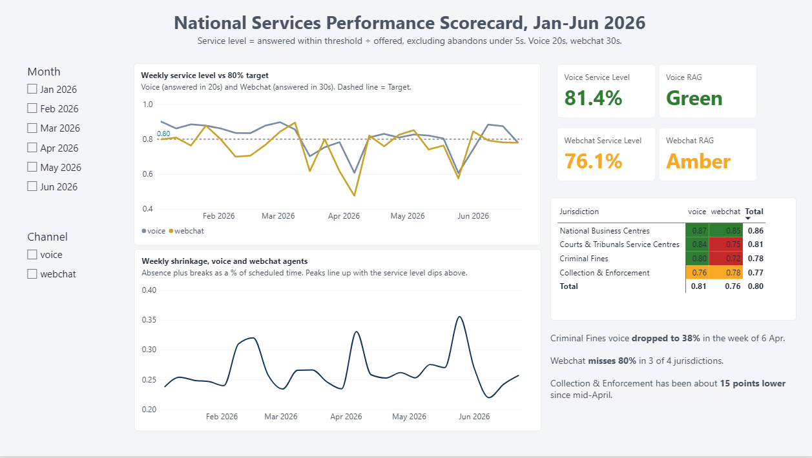
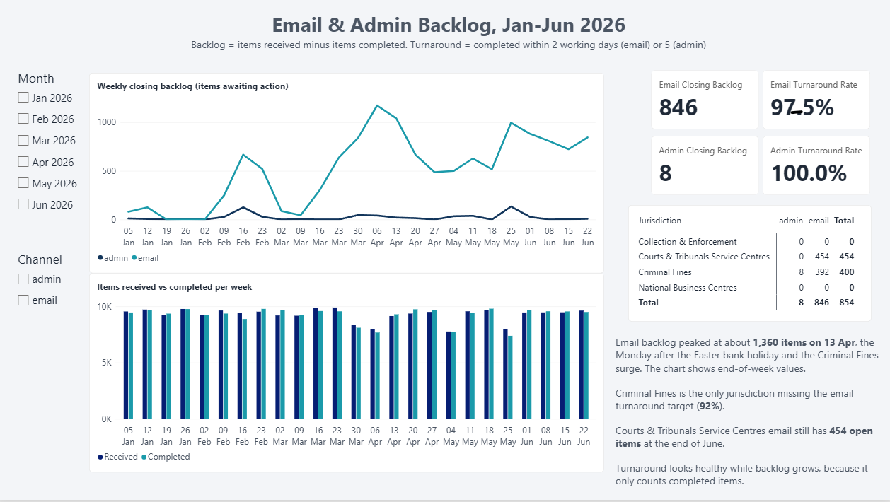
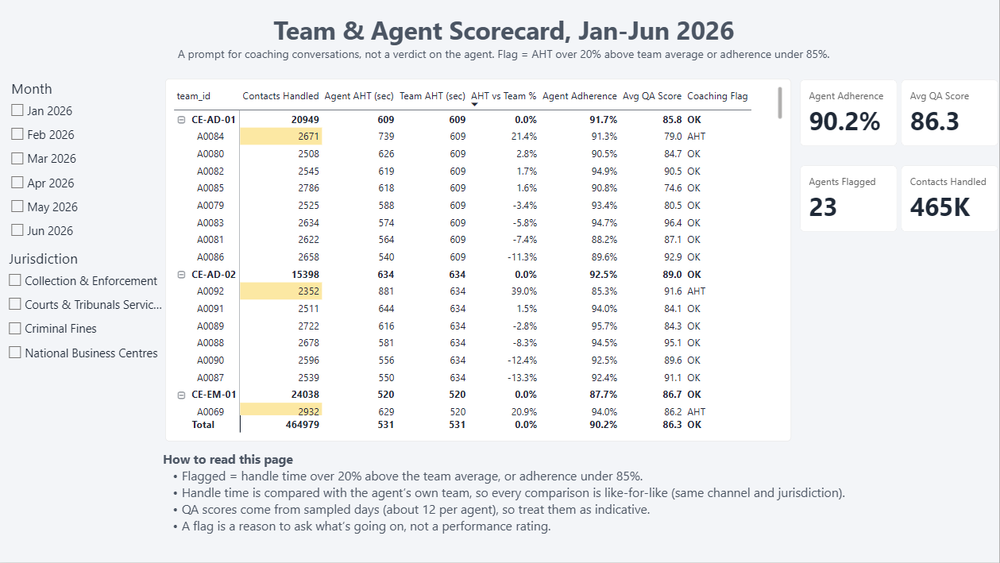

# Project 1: National Services Performance Scorecard

A BigQuery + Power BI scorecard for a national contact centre operation (voice, webchat, email, admin), built on **synthetic data**.

> **All data in this project is synthetically generated in Python (seed 42) to mimic a national public-sector contact centre. It is not real HMCTS or Ministry of Justice data, and nothing here reflects the real performance of any organisation.**

---

## 1. Why I built this

Contact centre leaders need one trusted answer, every week, to "are we hitting our targets, and where aren't we?" Team leaders need something concrete to base coaching conversations on. Without one agreed definition of each KPI, different reports give different numbers and the conversation turns into an argument about the data.

This project takes raw multi-system data, cleans it with documented rules, defines each KPI once in SQL, and presents it at three levels: national, jurisdiction, and team/agent. It practises the work in the Ministry of Justice Data Analyst (HMCTS National Services) role: performance reporting, KPI tracking, scorecards tailored by jurisdiction, and explaining performance deviations to stakeholders.

## 2. The data

| Table | Contents | Size |
|---|---|---|
| `interactions_raw` | One row per contact (voice, webchat) or work item (email, admin) | 498,347 rows |
| `agents` | Agent, team, team leader, jurisdiction, primary channel (IDs only, no personal data) | 156 agents |
| `agent_daily` | Schedule, absence reason, breaks, adherence minutes, occasional QA score | 18,876 rows |
| `targets` | KPI targets by channel | 4 rows |
| `bank_holidays` | Bank holidays in the period | 4 rows |

Period: 5 Jan to 26 Jun 2026. Four jurisdictions (Criminal Fines, Collection & Enforcement, National Business Centres, Courts & Tribunals Service Centres), four channels.

The raw data was deliberately generated with realistic problems (below) so the cleaning work is genuine.

## 3. Data cleaning

All cleaning is done in BigQuery views. The raw tables are never changed. The rule throughout: **flag, don't silently delete**, so every exclusion is visible and countable.

| Problem | Rule applied | Rows affected |
|---|---|---|
| Duplicates (same contact logged by a second system) | Dedupe on `interaction_id` + `received_at`; keep the primary system's row over `LegacyCRM` | 7,365 removed |
| Inconsistent labels ("Crim Fines", "CF", "C&E", "Web Chat", "Phone"...) | Mapped to 4 jurisdiction names and 4 channel names via `CASE`; anything unmapped is labelled `UNMAPPED` so it can't hide | 0 unmapped |
| Missing `agent_id` on handled contacts | Kept in the data and flagged; excluded only from agent-level scorecards | 4,601 |
| Missing `handle_seconds` | Flagged `missing`; excluded from AHT and occupancy, not imputed | 3,691 |
| Impossible handle times of 0 seconds | Flagged `zero`; excluded from AHT and occupancy | 1,362 |
| Impossible handle times over 2 hours | Flagged `too_long`. Threshold chosen from the data: genuine handle times peak near 6,000s, so 7,200s separates real long calls from errors | 444 |
| Short abandons (abandoned within 5 seconds) | Flagged; excluded from abandonment rate and service level, following the usual contact centre convention | 6,791 |
| Mixed time grain (voice/webchat timestamped, email/admin dated only) | Everything gets a `received_date`; only timed channels get a timestamp and 30-minute interval | n/a |
| Email/admin items still open at the end of the period | Kept; these are the backlog, not errors | 854 |

After cleaning: 490,982 rows.

## 4. KPI definitions

Every KPI is defined once, in SQL, and stored as numerators and denominators. Power BI sums the parts and then divides. It never averages percentages.

| KPI | Definition |
|---|---|
| Offered | Contacts reaching the queue, excluding short abandons |
| Service level | Answered within threshold / offered. Voice 20s, webchat 30s. Target 80% |
| Abandonment rate | Abandoned after 5s / offered. Target under 5% |
| AHT | Total valid handle seconds / count of valid handled contacts |
| Closing backlog | Cumulative received minus cumulative completed at end of day (email and admin) |
| Turnaround rate | Completed within target working days / completed. Email 2 days, admin 5. Target 90% |
| Occupancy | Valid handle minutes / available minutes |
| Adherence | In-adherence minutes / scheduled work minutes (absence days excluded from the denominator). Target 90% |
| Shrinkage | (Absence + break minutes) / scheduled minutes |

RAG colouring on service level: **Green** at or above 80%, **Amber** within 5 points, **Red** more than 5 points below. The 5-point amber band is a design choice, not an official standard.

## 5. What kind of analysis, and why

This is **descriptive KPI analysis with drill-down**: what happened, and where?

I chose it deliberately and first. Before anyone can ask *why* service level missed target, everyone has to agree what service level *is* and trust the number. Building a forecast or a model on KPIs that stakeholders dispute would be wasted effort. The scorecard gives a single, auditable set of definitions that Projects 2 (capacity planning) and 3 (root cause analysis) build on.

The logic lives in SQL views rather than Power BI measures so the numbers are reproducible and auditable outside the dashboard.

## 6. The dashboard

**Page 1: National Overview.** Voice and webchat service level cards with RAG colour, a weekly service level trend against the 80% target, a jurisdiction x channel matrix coloured by RAG, and a weekly shrinkage chart aligned beneath it.

**Page 2: Email & Admin Backlog.** Closing backlog and turnaround cards, weekly closing backlog, items received vs completed per week, and backlog by jurisdiction.

**Page 3: Team & Agent Scorecard.** *(add once built: AHT, AHT vs team, adherence, QA and coaching flags by team and agent)*

* 






*

## 7. Results

| Measure | Result |
|---|---|
| Voice service level (offered 186,647) | 81.4% against an 80% target |
| Webchat service level (offered 66,115) | 76.1%, below target |
| Abandonment rate | Voice 4.6%, webchat 7.9% (webchat above the 5% limit) |
| AHT | Voice 436s, webchat 631s |
| Adherence / shrinkage / occupancy | 90.2% / 25.8% / 66.1% |
| Email and admin backlog at end of June | 846 and 8 items |
| Turnaround | Email 97.5%, admin 100% |

What the scorecard shows:

1. **Webchat misses target in 3 of 4 jurisdictions** (Criminal Fines 72%, Courts & Tribunals Service Centres 75%, Collection & Enforcement 78%), even though the national voice figure is green.
2. **Voice service level drops sharply in two weeks**, the weeks starting 6 Apr and 25 May, both to about 61%. Both are bank-holiday weeks and coincide with the highest annual leave in the period. Criminal Fines also falls to 38% in the week of 6 Apr, during a period of unusually high volume.
3. **The email backlog builds in three waves** (mid-February, March-April, late May) and has not fully recovered by the end of June. Courts & Tribunals Service Centres and Criminal Fines hold all of the open items.
4. **Occupancy averages 66% against an 80% target, yet service level is borderline.** The operation is not short of staff on average. The problem is when and where staff are available, which motivates Project 2.

These patterns are descriptive. Project 3 breaks the deviations into volume, handle time, shrinkage and availability effects.

## 8. Who this helps

| Audience | What they use |
|---|---|
| Directors | National page: service level vs target, RAG by jurisdiction |
| Operations managers | Jurisdiction and channel drill-down, backlog trends, shrinkage by week |
| Team leaders | Team and agent scorecard for coaching conversations (a prompt for a conversation, not a verdict on the agent) |
| Workforce planners | Occupancy, shrinkage and adherence, which feed Project 2 |

## 9. Limitations

- **The data is simulated.** Patterns are plausible, but real data would be messier and I would expect different results.
- **Turnaround only counts completed items,** so it can look healthy while a backlog is growing. Backlog is the more informative measure. Admin turnaround was 100% because admin items were nearly always cleared the same day, so I treated it as a health check, not a finding.
- **Voice and webchat have different service level thresholds** (20s and 30s), so a combined figure would mislead. The dashboard reports them separately.
- **Occupancy is slightly understated** because handle time is only counted where it is valid (about 2% of handled rows are excluded).
- **The amber band and the 7,200-second ceiling** are judgement calls, documented above.

## 10. Tools and how to reproduce

Python (pandas, numpy) to generate the data, Google BigQuery for SQL, Power BI Desktop for the dashboard. I built this with the help of an AI assistant and can explain every query and measure.

```
generate_contact_centre_data.py   # creates the synthetic CSVs (seed 42)
01_cleaning.sql                   # staging view, clean table, data quality audit
02_kpis.sql                       # KPI fact tables and validation queries
03_powerbi_measures.dax           # Power BI measures
moj_scorecard_theme.json          # dashboard theme
```
